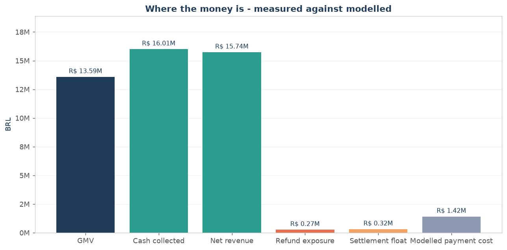

# Olist Marketplace — Financial Operations & Revenue Analytics

**How much money has the marketplace collected that it has not earned, what does the
payment mix cost to serve, and where is the cash at risk?**

An end-to-end portfolio case study on a real Brazilian e-commerce dataset:
**99,441 orders**, **103,886 payment transactions**, **112,650 line items**,
**R$ 16.0 million** of cash collected across 26 months.

SQL (7 files, 55 documented queries) · SQLite warehouse · **Excel** (12-sheet workbook with
native charts) · **Power BI** (star schema, 59 DAX measures, 5 report pages) · 8 figures ·
20 data-quality checks · **30 automated tests**.

[Executive summary](reports/executive_summary.md) ·
[Findings](reports/findings.md) ·
[Business decision report](reports/business_decision_report.md) ·
[SQL results](reports/sql_results.md) ·
[Data quality](reports/data_quality.md) ·
[Methodology](docs/methodology.md) ·
[Power BI](powerbi/README.md)

---

## 1. Executive summary

The marketplace collected **R$ 16,008,872.12** from customers. It should have collected
**R$ 15,848,243.14**. The books do not close, and the difference is not rounding: it is
**R$ 162,591.95 of cash sitting on orders for which the dataset contains no merchandise
record at all**.

| KPI | Value | Basis |
|---|---:|---|
| GMV (merchandise value) | R$ 13,591,643.70 | measured |
| Cash collected | R$ 16,008,872.12 | measured |
| Refund exposure | R$ 269,735.11 | measured (proxy) |
| **Net revenue** | **R$ 15,739,137.01** | measured |
| Reconciliation gap | R$ 160,628.98 | measured |
| Average order value | R$ 160.99 | measured |
| Freight ratio | 16.6% of GMV | measured |
| Reconciliation break rate | 1.227% of orders | measured |
| Repeat customer rate | 3.119% of customers | measured |
| Seller HHI | 0.00357 | measured |
| Modelled payment cost | R$ 1,418,757.17 | **modelled** |

### The seven findings

1. **The books do not close.** 1,220 orders (1.227%) fail the cash-to-revenue
   reconciliation, carrying R$ 170,716.88 of gross break value. 772 of them have cash
   collected and **no line items at all**.
2. **Refund exposure is R$ 269,735.11** — 1.68% of cash collected — and it is volatile:
   the monthly rate moves from 0.331% to 5.381%, a 16× swing.
3. **Instalments are the largest modelled cost.** R$ 990,121.38 of modelled instalment
   funding on R$ 10,101,491.12 of instalment-funded card volume (80.541% of card value at
   a value-weighted depth of 4.967 instalments) — bigger than acquiring cost
   (R$ 428,635.79) and promotional credit (R$ 379,436.87) combined.
4. **Logistics is deteriorating as the business scales.** Freight collected is
   R$ 2,256,599.44, 16.6% of GMV. The freight ratio moved **+1.08 points** year-on-year
   (15.98% → 17.06%) while cash grew **+136.98%**.
5. **Dispute risk rises with instalment depth** — 12.96% at one instalment to 21.08% at
   13+, covering R$ 2,769,252.32 of cash. Voucher-funded orders carry the highest dispute
   rate of all (16.24%).
6. **Seller concentration is not the risk.** HHI 0.00357; the top 10 sellers hold 13.15%
   of GMV. The real concentration is regional: São Paulo hosts 1,849 of 3,095 sellers and
   64.4% of GMV.
7. **Growth is acquisition, not retention.** Like-for-like, cash grew +136.98% and orders
   +135.07%, but average order value grew **+0.81%** and only 3.119% of customers ever
   reordered.



---

## 2. The dataset, and why this one

**Brazilian E-Commerce Public Dataset by Olist** — published by Olist (olistbr) /
André Sionek, 2018.

| | |
|---|---|
| Nature | **REAL commercial data**, anonymised by Olist (not synthetic, not simulated) |
| Licence | CC BY-NC-SA 4.0 — non-commercial use, attribution and share-alike required |
| Source | [Kaggle](https://www.kaggle.com/datasets/olistbr/brazilian-ecommerce) · [Olist's own repository](https://github.com/olist/work-at-olist-data/tree/master/datasets) (used by `src/fetch_data.py`) |
| Tables | 8 CSVs, 412,190 rows in total |
| Window | 2016-09-04 to 2018-10-17 |
| Currency | BRL (Brazilian reais) |
| What was anonymised | Customer names/contacts, seller identities, addresses. Transaction economics (price, freight, payment value, instalment count) are preserved. Company names in review text were replaced with *Game of Thrones* house names. |

### Candidates evaluated

| Dataset | Source / licence | Why it was not chosen |
|---|---|---|
| **Olist e-commerce** (chosen) | Kaggle / Olist GitHub, CC BY-NC-SA 4.0, **real** | — |
| Receiver General Accounting Transactions (Canada) | Public Services and Procurement Canada, Open Government Licence, **real** | 91% of rows have a null general-ledger account code and 92% a null journal-voucher id, so revenue cannot be classified into income and expense. A data-quality project with no financial story. |
| Salad Money Open Banking transactions | Smart Data Research UK, **real**, access-restricted | Requires a UK academic identity and a Trusted Research Environment application; not reproducible for a portfolio reviewer. |
| USAspending federal awards | US Government, **real**, open API | Spending only — no revenue, no customer, no payment instrument. Answers a budgeting question, not a financial-operations one. |
| Fraud-labelled card datasets | Kaggle, **synthetic** | Synthetic by construction and no refund, instalment or settlement semantics. |

### Why Olist fits a Financial Data Analyst brief

A marketplace like this is a **financial operations business**: it collects the customer's
money, holds it, pays the seller later, and takes a fee. That produces exactly the fields
a finance team works with — what was charged, what was collected, how it was collected,
whether the order was fulfilled, and whether the money came back.

The dataset contains, in native form:

- **revenue and cash**: merchandise price, freight collected, payment value;
- **payment instrument economics**: card / boleto / debit / voucher, with **instalment
  depth** — genuine consumer credit;
- **settlement mechanics**: order status from purchase to delivery, and the promise date;
- **disputes**: 99,224 review scores, the only outcome signal available;
- **counterparty and geography**: 3,095 sellers, 27 customer states, 74 categories.

It does **not** contain refunds, chargebacks, complaints, logistics cost, marketing spend
or margin. Those limits are stated wherever they matter, and no metric is derived from
what is missing.

---

## 3. Business context

**The process.** A customer buys from a third-party seller through a marketplace. The
customer pays by card (optionally in instalments), boleto, debit card or a marketplace
voucher. The marketplace collects the money, holds it until the order is delivered, then
pays the seller. Orders can be cancelled or become unavailable, in which case the money
has to go back. That is a receivables, a float and a refund-provision problem, and it is
what this analysis measures.

**Who uses it.** Head of Finance / Financial Operations Manager at the marketplace,
preparing the monthly reporting pack and setting the reserve policy.

**What it supports.** Whether to report on GMV or on net revenue; how large the refund
provision should be; whether the payment mix is affordable; where to act on the
reconciliation break.

**The business problem, stated precisely.** *The finance team reports GMV, which is
neither the cash collected nor the revenue earned, and the extract cannot reconcile the
difference. This analysis quantifies the gap, separates its causes, and identifies which
decisions are available once the books close.*

---

## 4. Method

Full detail in [`docs/methodology.md`](docs/methodology.md). The pipeline is four stages:

```
src/fetch_data.py  ->  src/build_db.py  ->  src/clean_data.py  ->  src/run_queries.py
                                                                     |
                                          src/analyze.py  <--------+
                                                |
        +-------------------+-------------------+-------------------+
        |                   |                   |                   |
   excel/*.xlsx      powerbi/*.pbit        reports/*.md       reports/figures/*.png
```

### Metric definitions (locked in `src/config.py`)

| Metric | Formula | Basis |
|---|---|---|
| GMV | `SUM(order_items.price)` | measured |
| Cash collected | `SUM(payments.payment_value)` | measured |
| Expected charge | `GMV + freight` per order | measured |
| Reconciliation break | order where `ABS(cash − expected) ≥ R$ 0.01` | measured |
| Refund exposure | cash collected on orders with status `canceled` / `unavailable` | measured **proxy** |
| Net revenue | cash collected − refund exposure | measured |
| Average order value | cash collected ÷ orders | measured |
| Freight ratio | freight collected ÷ GMV | measured |
| Disputed order | worst review score ≤ 2 of 5 | measured **proxy** |
| Seller HHI | Σ (seller GMV share)² | measured |
| Modelled payment cost | acquiring + instalment funding from market rates | **modelled** |

### Cleaning rules (and nothing else)

Seven rules, all recorded in `dq_cleaning_rules` and `data/processed/cleaning_log.csv`:

| # | Rule | Effect |
|---|---|---|
| R1 | `payment_installments = 0` → NULL | 2 rows; zero is not an instalment count |
| R2 | Timestamps parsed to ISO-8601 | all timestamp columns |
| R3 | Categorical text trimmed and lower-cased | 5 tables |
| R4 | **No row deleted** — including the 775 orders with cash and no line items | they carry R$ 162,591.95 of cash |
| R5 | **No amount edited** — the break is reported, never adjusted | — |
| R6 | Customers keyed on `customer_unique_id`, not `customer_id` | 2,997 customers are split across ids |
| R7 | Partial boundary months excluded from trend and YoY analysis | Sep 2016 (4 orders) and Oct 2018 (4 orders) |

---

## 5. Deliverables

### SQL — `sql/`, 55 documented queries

| File | Contents |
|---|---|
| `01_schema.sql` | 8 source tables with types, keys and 10 indexes; the cleaning-rule audit table |
| `02_views.sql` | 6 analytic views: `v_order_financials` (the order-level fact), `v_payment_detail`, `v_item_financials`, `v_seller_performance`, `v_category_financials`, `dim_date` |
| `03_data_quality.sql` | 14 control checks — uniqueness, referential integrity, null profile, temporal integrity, partial-month coverage, fact-vs-view reconciliation |
| `04_revenue_and_cash.sql` | headline, status mix, monthly series, MoM, like-for-like YoY, quarterly, settlement float, customer economics, geography |
| `05_payment_mix_and_cost.sql` | method mix, instalment profile, modelled cost-to-serve, funding-rate sensitivity, voucher analysis, method-shift scenario |
| `06_exposure_and_reconciliation.sql` | refund exposure, break summary and structure, material exceptions, anomaly screen, 12-KPI scorecard |
| `07_concentration_and_risk.sql` | seller concentration and HHI, category logistics, dispute risk by instalment depth, SLA vs dispute |

Every query carries a `-- name:` / `-- description:` header; `src/run_queries.py` executes
them all and writes `reports/sql_results.md` as the audit trail behind every number.

### Excel — `excel/Marketplace_Financial_Ops_Dashboard.xlsx`

12 sheets: README · KPI Scorecard · Monthly Financials · Revenue & Growth · Payment Mix ·
Refund Exposure · Reconciliation · Seller Concentration · Category Logistics · Dispute
Risk · Data Quality · Order Records.

All charts are **native Excel charts** (right-click → Edit Data to re-point a series).
The *Order Records* sheet carries the cleaned order-level fact with every measure as a
column, ready for `Insert > PivotTable`.

### Power BI — `powerbi/`

A star schema (3 facts, 5 dimensions), **59 DAX measures**, and **5 report pages**:
Executive Overview · Revenue and Growth · Payment Mix and Cost to Serve · Exposure and
Reconciliation · Concentration and Risk.

The model is generated from `src/build_powerbi_model.py`, so the DAX catalogue
(`powerbi/measures.dax`), the semantic model (`model.bim`) and the report layout
(`report.json`) cannot drift apart. The modelled cost rates live in `DimPaymentMethod`,
so the cost-to-serve numbers can be re-run against different assumptions by editing one
table.

> **Status note.** The PBIP project was opened in Power BI Desktop 2.159.883.0
> (October 2026): the semantic model loads with all 8 tables and all 5 report
> pages. The report definitions are emitted in the **PBIR** format with field
> bindings (`visual.query.queryState`), which is the format Power BI Desktop
> reads from a PBIP project; the legacy `report.json` alongside them is the
> portable copy. The rendered output after a data refresh was **not** confirmed
> on this machine. See [`powerbi/README.md`](powerbi/README.md) for the
> open-and-refresh steps and for a known version caveat in the `.pbit` compile
> path.

---

## 6. Findings and recommendations

Full narrative in [`reports/findings.md`](reports/findings.md) and
[`reports/business_decision_report.md`](reports/business_decision_report.md).

### Verified findings (measured)

| # | Finding | Significance | Action a manager could consider |
|---|---|---|---|
| 1 | 1,220 orders fail the cash-to-revenue reconciliation; R$ 162,591.95 of cash has no merchandise record | 1.227% of orders; 1.02% of cash collected | Raise a control ticket with the order-management extract; do not restate revenue until the content is recovered |
| 2 | Refund exposure R$ 269,735.11 (1.68% of cash), swinging 16× month to month | Directly reduces cash available to settle sellers | Set a reserve policy on the monthly rate, not the lifetime average; model the bad months |
| 3 | Modelled instalment funding R$ 990,121.38 on R$ 10.1m of instalment-funded card value | 6.29% of net revenue — the largest single modelled cost | Price the payment mix: compare the per-order card cost against the R$ 3.00 boleto cost, and test a checkout incentive |
| 4 | Freight ratio up 1.08 points YoY while cash grew 137% | Logistics is not scaling | Pilot carrier-pricing or seller-terms changes on the heaviest categories (office furniture 25.03%, housewares 23.26%) |
| 5 | Dispute rate rises monotonically with instalment depth (12.96% → 21.08%); voucher orders are worst at 16.24% | R$ 2,769,252.32 of cash behind a 1–2 star review | Review the voucher targeting policy; quantify the chargeback cost of long instalment plans |
| 6 | Seller concentration is negligible (HHI 0.00357); São Paulo holds 64.4% of GMV | Counterparty risk is low, regional risk is not | Monitor regional supply exposure rather than individual sellers |
| 7 | Repeat customer rate 3.119%; AOV +0.81% against cash +136.98% | Growth is 100% acquisition | Requires lifetime-value and acquisition-cost data before any retention spend can be justified |

### Hypotheses and unmeasured impact — explicitly not claimed

- The instalment-depth / dispute-rate relationship is an **association**, not a
  demonstrated cause.
- **No saving, avoided loss or prevented fraud is claimed anywhere in this project**,
  because no intervention was run and no counterfactual was measured. The method-shift
  scenario in `p08_method_shift_scenario` is a model, labelled as one.
- Refund exposure and disputed value are **proxies**; the source has no refund,
  chargeback or complaint table.

### What would be needed before acting

1. The order-detail extract for the 1,220 orders in break.
2. The actual refund transactions, to replace the exposure proxy.
3. The marketplace's real acquiring contract, to replace the published market rates.
4. Marketing spend and gross margin, without which no retention or acquisition
   investment can be appraised.

---

## 7. Data-quality findings worth knowing

| Finding | Records | Why it matters |
|---|---:|---|
| Orders with cash but no line items | 775 (772 with cash) | R$ 162,591.95 invisible to any line-item revenue report |
| `review_id` recorded against two orders of the same customer, with identical content and timestamps | 789 ids / 1,603 rows | A one-review submission counted twice; order-level attribution keeps both links, review-level counts use `COUNT(DISTINCT review_id)` |
| One customer spread across 17 `customer_id` values | 2,997 customers | Counting customers on `customer_id` overstates the base by 3.5% and understates the repeat rate |
| Line items where freight exceeds the merchandise value | 4,119 (3.66%) | R$ 27,659.95 of freight charged above the goods value |
| Orders with more than one review row | 547 | The review table is not one-per-order and must be aggregated |
| Payments with a zero value | 9 | Excluded from averages, retained in totals |
| Orphan rows on any foreign key | **0** | Referential integrity is clean |

Everything else is clean: no duplicate primary keys, no negative amounts, no
temporal inconsistencies, no unmapped categories above 13 products.

---

## 8. Additional analyses this dataset supports

Ranked by business value for the target roles:

| # | Next analysis | Why it is worth doing | Data it needs |
|---|---|---|---|
| 1 | **Monthly financial close pack** — one reproducible script that produces the manager's monthly pack from raw CSVs | Turns a one-off analysis into the recurring reporting workflow a Financial Operations Analyst actually owns | This dataset as-is |
| 2 | **Transaction anomaly report** — a scored exception list (break value, instalment depth × dispute rate, freight-to-price ratio, order size vs category norm) | A control that runs on every close, not once | This dataset as-is |
| 3 | **Cohort retention on `customer_unique_id`** — the 3.119% repeat rate is the single biggest unknown | Would tell the business whether the 137% growth is worth anything | This dataset as-is |
| 4 | **Payment-mix what-if dashboard** — swap the rates in `DimPaymentMethod` and watch contribution move | Makes the modelled cost honest and explorable rather than a table of numbers | This dataset + a real contract |
| 5 | **Seller and category contribution model** — allocate freight and modelled payment cost per seller and per category, then rank by contribution rather than GMV | GMV ranks sellers badly; contribution ranks them correctly | This dataset + logistics cost |
| 6 | **Dispute-risk scorecard** — a pre-dispute early-warning signal built from instalment depth, basket size and category | Moves the finance team from counting disputes after the fact to flagging exposure before it lands | This dataset as-is |

Each of these is a natural extension of the existing warehouse: the star schema, the
views and the measure layer are already in place.

---

## 9. Reproducing this project

```bash
# 1. environment
python -m venv .venv && .venv\Scripts\activate        # Windows
pip install -r requirements.txt

# 2. run everything (downloads the data on the first run)
python src/run_all.py

# or stage by stage
python src/fetch_data.py          # source CSVs  -> data/raw/
python src/build_db.py            # warehouse    -> marketplace_finance.db
python src/clean_data.py          # clean tables -> data/processed/
python src/run_queries.py         # analysis SQL -> reports/sql_results.md
python src/analyze.py             # findings     -> reports/*.md, key_metrics.json
python src/build_excel.py         # Excel        -> excel/*.xlsx
python src/build_powerbi_data.py  # star schema  -> powerbi/MarketplaceFinance/Data/
python src/build_powerbi_model.py # PBIP         -> powerbi/MarketplaceFinance/
python src/make_figures.py        # figures      -> reports/figures/

# 3. check the numbers
python -m pytest tests/ -v
```

The pipeline is deterministic: same input, same output. The SHA-256 digest of every
source file is recorded in `src/fetch_data.py` and verified on download.

> **The data is not committed.** The Olist source CSVs (~61 MB) and the derived
> artefacts (the SQLite warehouse, `data/processed/`, the Power BI star schema)
> are git-ignored. `python src/run_all.py` fetches the source and rebuilds
> everything from scratch.

> `marketplace_finance.db` is a **build artifact** (about 185 MB — it holds the
> materialised order-level fact with five indexes). It is fully reproducible with
> `python src/build_db.py` and can be deleted and rebuilt at any time; the
> processed CSVs, the workbook and the reports are the durable outputs.

### Project layout

```
olist-marketplace-financial-operations-analysis/
├── README.md                     this file
├── requirements.txt
├── marketplace_finance.db         SQLite warehouse (built)
├── data/
│   ├── raw/                      8 source CSVs (git-ignored - fetched by src/fetch_data.py)
│   ├── processed/                cleaned tables + analysis extracts (git-ignored)
│   └── README.md                 field dictionary, provenance, digests
├── docs/
│   ├── methodology.md            definitions, rules, limitations
│   └── implementation_plan.md    how the project was built
├── sql/                          7 files, 55 documented queries
├── excel/                        the workbook
├── powerbi/
│   ├── MarketplaceFinance/       the PBIP project (model + 5 report pages)
│   ├── Data/                     the star-schema CSVs (git-ignored)
│   ├── measures.dax              the DAX catalogue (generated)
│   ├── data_model.md             the star schema and relationships
│   ├── power_query.md            the Power Query definitions
│   ├── build_pbit.py             compiles the .pbit template
│   └── README.md
├── reports/
│   ├── executive_summary.md      findings.md        business_decision_report.md
│   ├── sql_results.md            data_quality.md/.json
│   ├── key_metrics.json          every figure, machine-readable
│   └── figures/                  8 PNG exhibits
├── src/                          the pipeline (11 modules)
└── tests/                        30 automated financial controls
```

---

## 10. Skills demonstrated

**SQL** — an eight-table warehouse with declared keys and indexes; a six-view analytic
layer; a materialised order-level fact reconciled against its defining view; window
functions for the Pareto and the MoM series; `CASE`-based status classification; 42
documented, reproducible analysis queries.

**Excel** — a 12-sheet workbook with native charts, conditional formatting, a KPI
scoreboard that separates measured from modelled, and a pivot-ready order-level fact.

**Power BI** — a three-fact, five-dimension star schema; 59 DAX measures including
time-intelligence, dynamic segmentation and `RELATED`-based cost modelling; slicers,
cards and drill-style charts across five pages; a model generated from code so it cannot
drift from the documentation.

**Financial analysis** — cash-versus-revenue reconciliation; a refund-exposure proxy; a
market-rate cost-to-serve model with a published sensitivity band; concentration
analysis (HHI, Pareto); a dispute-risk gradient; explicit separation of measured facts,
modelled estimates and hypotheses.

**Data quality** — 20 recorded controls, an audit table inside the warehouse, a
documented cleaning log, and seven rules that deliberately *do not* delete or adjust
anything.

**Communication** — findings written as *what the data shows → why it matters → what a
manager could consider → what is still missing*, with every modelled figure labelled and
no unmeasured impact claimed.

---

*Built by **Rafael Silva** — Data Analyst · SQL · Excel · Power BI.*
*Dataset: Brazilian E-Commerce Public Dataset by Olist (CC BY-NC-SA 4.0). Real,
anonymised commercial data.*
